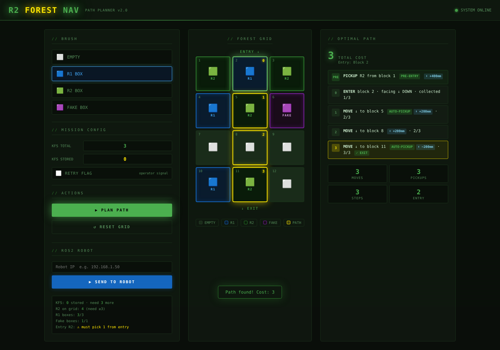
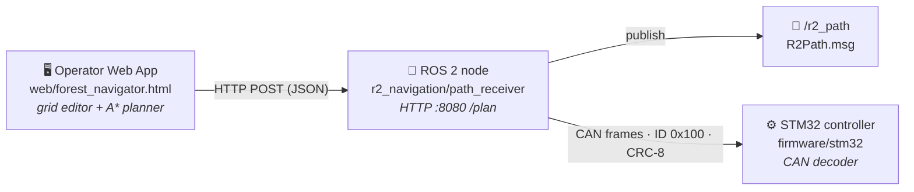

<div align="center">

# R2 Forest Navigator

**Real-time A\* path planning for an autonomous Robocon robot — from operator tablet to STM32 over CAN.**




</div>

---

## Overview

In **ABU Robocon 2026**, the R2 robot must cross a 4 × 3 "forest" of raised blocks (200 / 400 / 600 mm), collect a set number of its own boxes (KFS), avoid fake boxes, coordinate with the R1 robot, and leave through the exit row — all against the clock.

The box layout is only known at match time, so the route can't be hard-coded. **R2 Forest Navigator** solves this end-to-end:

1. The operator paints the observed layout on a tablet/laptop web app.
2. An **A\* search** finds the cheapest route in milliseconds.
3. The plan is sent over Wi-Fi to a **ROS 2** node on the robot.
4. The node publishes it as a ROS message and packs it into a compact, CRC-protected **CAN** packet for the **STM32** motion controller.

## System Architecture



## Key Features

- **Cost-minimising A\* planner** over a full robot state — position, heading, boxes collected and *which* boxes were picked — packed into a 13-bit key for fast hashing.
- **Realistic cost model**: moves, 90°/180° turns, reverse-driving penalty, pickup rotation, and waiting for R1 to clear a shared block.
- **Rule-aware search**: fake boxes are impassable, R2 boxes block the path once the quota is met, entry-row boxes may be collected before entering, and every entry block is evaluated to pick the global best.
- **Arm height planning**: each step carries the signed height change between blocks (−400 … +600 mm) so the lifter can be pre-positioned.
- **Variable mission targets**: supports `KFS total` / `KFS stored` and an operator retry flag for mid-match re-planning.
- **Zero-dependency operator UI**: one self-contained HTML file, runs offline in any browser; live constraint checks and step-by-step route visualisation.
- **Shared CAN codec** in C++17 (ROS side) and C99 (STM32 side): no dynamic allocation, 8-byte frames, CRC-8/SMBUS, worst case 9 frames (72 bytes).
- **Standalone C++ port** of the planner with built-in self-tests and benchmark scenarios.

## Repository Structure

```
forest_planner/
├── web/
│   └── forest_navigator.html         # Operator web app (grid editor, A* planner, send-to-robot)
├── planner/
│   └── forest_navigator_planner.cpp  # Standalone C++17 port of the planner + self-tests
├── r2_navigation/                    # ROS 2 Humble package
│   ├── msg/
│   │   ├── R2Path.msg                # Full plan: entry/exit, cost, grid, steps
│   │   └── R2Step.msg                # Single action step
│   ├── include/r2_navigation/
│   │   └── can_packet.hpp            # Header-only CAN codec (C++17)
│   ├── src/
│   │   └── path_receiver_node.cpp    # HTTP → ROS 2 topic → CAN frames
│   ├── third_party/                  # httplib.h, json.hpp (single-header deps)
│   ├── CMakeLists.txt
│   └── package.xml
├── firmware/
│   └── stm32/
│       ├── Inc/can_packet.h          # CAN codec API for STM32CubeIDE (C99)
│       └── Src/can_packet.c          # Frame reassembly, CRC check, decoding
└── docs/
    └── images/
```

## How the Planner Works

**Field model.** Blocks B1–B12 in a 4 × 3 grid; the robot enters from row 1 (B1–B3) and must exit from row 4 (B10–B12). Each block holds one of `EMPTY`, `R1`, `R2` or `FAKE`.

```
        ENTRY ↓
  [ B1 ][ B2 ][ B3 ]      Heights (mm)
  [ B4 ][ B5 ][ B6 ]      200 : B2 B4 B10 B12
  [ B7 ][ B8 ][ B9 ]      400 : B1 B3 B5 B7 B9 B11
  [B10 ][B11 ][B12 ]      600 : B6 B8
        EXIT ↓
```

**Search state.** `(block, collected, facing, picked_mask)` → packed into a `uint16_t`.

**Actions.**
- `MOVE` to a neighbouring block (auto-collects an R2 box when standing on it)
- `PICKUP` an R2 box from an adjacent block without moving
- `PRE_ENTRY` pickup of entry-row boxes from the ground before entering

**Cost model.**

| Event | Cost |
|-------|-----:|
| Move one block | 1 |
| 90° turn | 1 |
| 180° turn | 2 |
| Driving backwards (towards entry) | +3 |
| Rotate to pick up from the side | +1 |
| Enter a block occupied by R1 (wait) | +3 |

**Heuristic.** Rows remaining to the exit + 2 × boxes still to collect.

The planner runs A\* from every valid entry configuration (including every subset of entry-row pickups) and returns the cheapest plan.

## CAN Protocol (summary)

All frames are sent on standard CAN ID `0x100`, are 8 bytes long and carry a CRC-8 in byte 7. A transfer starts with a header frame (magic byte `0xA2`).

| Frame | B0 | B1 | B2 | B3 | B4–B6 | B7 |
|-------|----|----|----|----|-------|----|
| **Header** | `0xA2` | total frames | total cost | meta (exit, entry, pre-entry count, retry) | grid: 12 × 2-bit box states | CRC-8 |
| **Step** | frame index | steps in frame (1–2) | step 0 (16 bit) | | step 1 (16 bit) · B6: height deltas | CRC-8 |

Each step is a 16-bit word: `action(2) | current_block(4) | target_block(4) | direction(2) | collected_after(3) | auto_pickup(1)`.
Full bit-level documentation is in [`can_packet.hpp`](r2_navigation/include/r2_navigation/can_packet.hpp).

## Getting Started

### 1. Operator web app

No build step — open the file in any modern browser:

```bash
xdg-open web/forest_navigator.html      # or just double-click it
```

Paint the layout → set **KFS total / stored** → **PLAN PATH** → enter the robot IP → **SEND TO ROBOT**.

### 2. Standalone planner (C++)

```bash
g++ -O2 -std=c++17 -o planner/planner planner/forest_navigator_planner.cpp
./planner/planner
```

Runs the self-tests followed by four benchmark scenarios:

```
  Test 1 PASS (cost=3, entry=B2, exit=B11, ENTER step present)
  ...
  All tests passed.

  Total cost    : 3
  Entry block   : B2
  Exit block    : B11
  [0] PRE_ENTRY  cur=0  tgt=B1   dir=DOWN  col=1  h=+400mm
  [1] MOVE       cur=0  tgt=B2   dir=DOWN  col=1  h=+200mm
  [2] MOVE       cur=2  tgt=B5   dir=DOWN  col=2  [AUTO-PICKUP]  h=+200mm
  [3] MOVE       cur=5  tgt=B8   dir=DOWN  col=2  h=+200mm
  [4] MOVE       cur=8  tgt=B11  dir=DOWN  col=3  [AUTO-PICKUP]  h=-200mm
```

### 3. ROS 2 package (Humble)

```bash
# inside your workspace
cd ~/ros2_ws/src
git clone https://github.com/imeselhy/forest_planner.git

# fetch the two single-header dependencies (see r2_navigation/third_party/README.md)
cd forest_planner/r2_navigation/third_party
curl -LO https://raw.githubusercontent.com/yhirose/cpp-httplib/master/httplib.h
curl -LO https://github.com/nlohmann/json/releases/latest/download/json.hpp

cd ~/ros2_ws
colcon build --packages-select r2_navigation
source install/setup.bash
ros2 run r2_navigation path_receiver_node
```

| Parameter | Default | Description |
|-----------|---------|-------------|
| `http_port` | `8080` | Port the web app posts to |
| `http_host` | `0.0.0.0` | Bind address |
| `path_topic` | `/r2_path` | Output topic (`r2_navigation/msg/R2Path`) |

```bash
ros2 topic echo /r2_path
```

### 4. STM32 firmware

Copy `firmware/stm32/Inc/can_packet.h` and `firmware/stm32/Src/can_packet.c` into your STM32CubeIDE project, then feed every received CAN frame into the decoder:

```c
#include "can_packet.h"

void HAL_CAN_RxFifo0MsgPendingCallback(CAN_HandleTypeDef *hcan) {
    CAN_RxHeaderTypeDef rx;
    uint8_t data[8];
    HAL_CAN_GetRxMessage(hcan, CAN_RX_FIFO0, &rx, data);

    static R2CAN_Path path;
    int rc = R2CAN_FeedFrame(rx.StdId, data, (uint8_t)rx.DLC, &path);
    if (rc == R2CAN_COMPLETE) {
        // complete, CRC-verified plan in `path` -> hand it to the motion task
    } else if (rc != R2CAN_WAITING) {
        R2CAN_Reset();   // CRC / sequence error: drop and wait for a fresh header
    }
}
```

## Tech Stack

| Layer | Technology |
|-------|------------|
| Operator UI | HTML5, CSS3, vanilla JavaScript (Fetch API) |
| Planning | A\* search, bit-packed state space, C++17 / JS |
| Robot middleware | ROS 2 Humble, `rclcpp`, custom `rosidl` messages, cpp-httplib, nlohmann/json |
| Embedded | STM32 (C99, HAL), CAN bus, CRC-8/SMBUS |

## Roadmap

- [ ] Transmit packed frames directly via SocketCAN (currently packed and logged)
- [ ] Unit tests for the CAN codec round-trip (C++ ↔ C)
- [ ] Launch file + YAML parameter config
- [ ] Gameplay video / field demo GIF

## Author

**Ibrahim Meselhy**
[GitHub](https://github.com/imeselhy) · [LinkedIn](https://www.linkedin.com/in/your-profile)

Developed for the R2 robot in ABU Robocon 2026.
